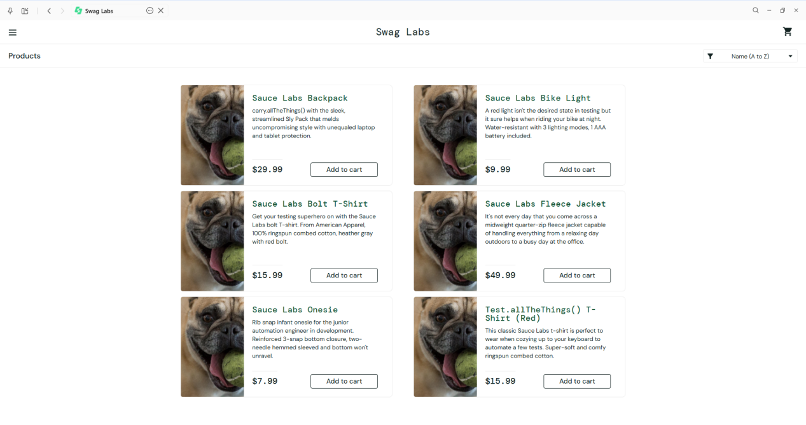
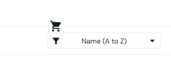
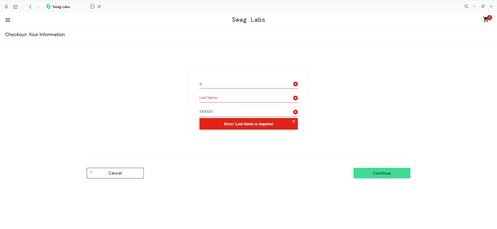

# 缺陷报告 bug_report
项目：SauceDemo Web电商测试
测试环境：Windows11，Microsoft Edge浏览器

缺陷ID：BUG001
标题：problem_user账号商品列表全部展示小狗图片，商品图片与商品信息不匹配
模块：商品列表页
严重等级：一般
优先级：中
复现频率：必现

前置条件：
1. 打开SauceDemo 登录页面
2. 使用 problem_user / secret_sauce 账号登录成功

复现步骤：
1. 登录problem_user账号，进入商品列表页面
2. 观察页面各个商品的图片展示

预期结果：
各个商品展示自身对应的商品图片：背包、车灯、T恤、外套、婴儿服、红T恤图片各自匹配商品描述。

实际结果：
全部商品统一展示小狗图片，图片与商品名称、描述不匹配。

---

缺陷ID：BUG002
标题：visual_user账号排序下拉框UI布局错位遮挡文字
模块：商品列表页
严重等级：一般
优先级：中
复现频率：必现

前置条件：
1. 打开SauceDemo，visual_user / secret_sauce登录成功，进入商品列表页

复现步骤：
1. 点击右上角排序下拉选择框

预期结果：
下拉选项完整展示，文字无遮挡，可正常点击切换排序

实际结果：
下拉框UI样式错乱，部分选项文字被遮挡。

---

缺陷ID：BUG003
标题：problem_user结算信息页，填写Last Name时会覆盖First Name的内容
模块：结算流程模块
严重等级：严重
优先级：高
复现频率：必现

前置条件：
1. 打开SauceDemo 网站，problem_user / secret_sauce 登录成功
2. 添加任意商品到购物车，进入购物车页面，点击Checkout，进入收货信息填写页

复现步骤：
1. 在First name输入框填入内容
2. 将光标切换到Last name输入框，输入内容
3. 观察First name输入框

预期结果：
First Name和 Last Name两个输入框相互独立，各自内容不会互相影响、覆盖。

实际结果：
只要在Last Name输入内容，First Name里面已经填好的内容就会被覆盖丢失，无法同时保存两个字段信息。

